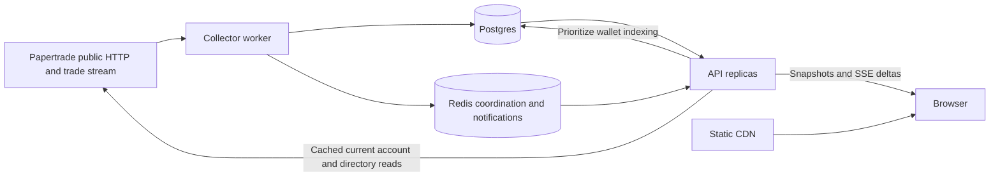

# Paperclub

A public, read-only dashboard for the Papertrade community. React renders protocol metrics, TVL history, observed trading activity, asset analytics, a rolling 24-hour leaderboard and a searchable wallet directory. Opening a wallet shows credited deposits, available balances, portfolio coverage and paginated cashflow/trade history. Individual positions have inspectable details and shareable receipt images. Following saves wallet identities in the current browser and reads refreshed summaries and observed activity in bounded batches, with each valuation's age shown separately.

The [live beta](https://papertrade.club) uses real public Papertrade sources and a continuously running collector backed by Postgres. Demo fixtures exist only in browser tests. It does not connect signing wallets, submit trades, move funds or require a blockchain node.

## Run locally

For read-only data access without running the dashboard, use the [public agent guide](https://papertrade.club/agents.md) or [CLI guide](docs/CLI.md). The production web build also publishes the standalone client at [paperclub.mjs](https://papertrade.club/paperclub.mjs). Supported all-execution counts use a rolling 24-hour window; arbitrary time ranges are not exposed.

Requires Node 24 and npm. From the repository root:

```sh
npm ci
cp .env.example .env
npm run dev
```

Open [http://127.0.0.1:5173](http://127.0.0.1:5173). The API runs on port 8787. Without `DATABASE_URL`, it starts a collector and persists data in `.data/paperdash.sqlite`; restart the app without losing stored observations. Initial content depends on the public source responding. An empty trade feed is a valid state.

To use PostgreSQL, set `DATABASE_URL` and `REDIS_URL` in `.env`, then run:

```sh
npm run db:migrate
npm run dev
```

In another terminal, run `npm run dev:ingest`. With Postgres configured, set `REDIS_URL` too: the API replicas and separate worker share one upstream request budget through Redis. Single-process SQLite development does not require Redis. See [.env.example](.env.example) for the actual settings; put no secrets in `VITE_*` variables because they enter the browser bundle.

## Build and verify

```sh
npm run build
npm test
npx playwright install chromium
npm run test:e2e
python3 -m unittest discover -s tests
```

The browser suite runs desktop and mobile flows against isolated synthetic API responses, including wallet navigation, asset selection, leaderboard sorting/pagination, deposit pagination through refreshes, partial-history labels, unavailable data, keyboard focus and local following. It does not establish live upstream correctness or production capacity. The Python tests cover the retained research CLI.

After building, `npm run start:api` and `npm run start:ingest` run the compiled backend processes. Serve `apps/web/dist` through a static host. In production, configure the public `VITE_API_URL` at frontend build time and the exact frontend `CORS_ORIGIN` on the API.

## Architecture



| Directory | Responsibility |
| --- | --- |
| `apps/web` | React/Vite interface, wallet drawer, local following |
| `apps/server` | Fastify API, source validation, collector, SQLite/Postgres storage, SSE replay |
| `packages/shared` | Browser/server data contracts |
| `tests/e2e` | Playwright fixtures and interaction tests |
| `docs/OPERATIONS.md` | Deployment, environment, permissions, backups and recovery |
| `research` | Protocol research, captured evidence and the longer-term design |

The collector saves global trade observations, minute TVL samples and wallet history in Postgres. A durable queue indexes cashflows, trades and portfolio history for wallets discovered through repeated directory sweeps, live trades and account lookups. Each page commits its records and progress together; the next worker resumes unfinished work after a restart. Raw history pages and portfolio batches are retained alongside the query projections.

Wallet history pagination reads local tables. Opening a wallet can prioritize its indexing job and refresh its current account snapshot, but does not download the wallet's upstream history for each visitor. API replicas and the worker use Redis for a shared upstream request budget and cache locks. Database-backed notification cursors support browser reconnection, with Redis accelerating fan-out. A database advisory lock coordinates the active collector. Local SQLite is for a single machine; Render replicas use shared Postgres.

Following reuses those ingestion and coordination primitives. Its batch endpoint reads retained per-address account summaries and bounded recent executions; it does not fetch each wallet from upstream. Viewing known wallets renews temporary collector refresh requests, shared across visitors. Source directory pages also refresh the same summary projection. Response time, valuation receipt time and activity coverage remain distinct; a successful poll cannot make an old valuation current. See the [staged feature plan](docs/FEATURE_CHUNKS.md).

Position cards reuse retained wallet outcomes and the current wallet snapshot through one shared interpretation of raw fields. Selecting a card freezes its values and observation context for image export. No extra collector, backfill or per-position source request is introduced. Missing funding, prices or payout information stay unavailable; adjusted PnL, fees and PAPER issuance remain separate. See [trade receipts](docs/TRADE_RECEIPTS.md).

Source money values remain integer decimal strings. UI amounts are formatted from those strings; chart coordinates and source-provided approximate trade displays are not an independent accounting ledger.

Assets show BTC/ETH entry-notional open interest, long/short notional shares, retained OI history and observed executions in the last 24 hours. The collector polls one shared current-market publication every five seconds and saves minute samples; browsing assets never downloads upstream history. Activity projections are committed with observations and backfilled once with a durable cursor. Minute aggregates plus exact time-boundary records answer rolling-window queries. API snapshots use compression and conditional browser revalidation.

The leaderboard defaults to the protocol's `totalWindowedPnl` for `window=24h`. Volume and execution-count rankings use our retained observations over a rolling 24 hours; all three can open a wallet. The asset and leaderboard tabs are directly linkable with `?view=assets` and `?view=leaderboard`.

## Data boundaries

TVL, wallet counts and lifetime amounts are reported by Papertrade. They are not independently reconciled against custody. We retain available wallet history and expose indexing progress, source coverage and ambiguous source identities. Reaching the end of the source's pagination means that available backfill finished; it does not establish a complete lifetime ledger. Missing data remains unavailable rather than becoming zero. Cached data retains freshness information.

Use `npm run ingest:status` from an environment with the database settings to inspect the collector heartbeat and queue. Add `--` followed by a full wallet address to inspect its checkpoints. `/api/indexing` provides a read-only, periodically saved aggregate without scanning the queue on each browser request.

The public stream lacks canonical transaction/event identifiers and the recent REST trade feed has limited retention. We retain observed activity, but cannot guarantee every execution during downtime or complete lifetime global history. This version does not have a verified-ABI blockchain backfill adapter. Canonical accounting, independent long-term backups and production load/failover drills remain launch work; the operations guide spells out those gates.

Observed execution counts include opens, closes and liquidations; they are not completed-position counts. Approximate execution volume is distinct from open interest. Long/short percentages divide each side's entry notional by both sides combined, not by the number of wallets or positions. At zero OI, the shares are unavailable. The upstream PnL calculation is not documented well enough to call it realized PnL, and source leaderboard account counts include inactive funded accounts. Feed outages retain saved data with delayed status.

Read the [current source evidence](research/DATA_SOURCES_2026-10-09.md) and [original dashboard plan](research/DASHBOARD_PLAN.md) for the investigation. The planning document's earlier $100–300 scenario is historical; the implementation's current $300–500 budget is below.

## Render

[render.yaml](render.yaml) defines a static frontend, two API instances, one collector, Redis-compatible Key Value and Postgres with an HA standby. [infra/render.blueprint.yaml](infra/render.blueprint.yaml) is an identical copy. CI checks schema validity and prevents the copies drifting. Service auto-deploy and preview environments start disabled; Blueprint auto-sync must be disabled separately in Render for manual releases. Key Value uses `noeviction` because it holds coordination locks as well as notifications.

The deployed stack's fixed cost estimate is **$300/month**, including a dedicated $25 Pro workspace, $50 for the two APIs, $25 for ingestion, $150 Postgres primary/standby compute, $30 storage and $20 Key Value. An illustrative public-source beta budget is **about $340/month** with egress and a backup allowance. A future $49 archive RPC adds up to approximately **$389/month** under the same assumptions; the current code does not need it. These estimates are not caps or measured traffic forecasts. [Render pricing](https://render.com/pricing).

Initial deployment uses the managed database owner to bootstrap the schema. Before broad public launch, provision restricted runtime roles, separate migration credentials, configure external backups and run the recovery/load checks in [the operations guide](docs/OPERATIONS.md). HA and multiple API instances improve availability; they do not make an incomplete source into a complete ledger.

## Retained Python research CLI

`papertrade.py` and the earlier protocol archives remain available. Python 3.9+ is sufficient; the CLI uses the standard library and emits JSON. Examples:

```sh
python3 papertrade.py status
python3 papertrade.py bbo BTC
python3 papertrade.py docs how/risk
python3 papertrade.py plan BTC long --margin 10 --leverage 10 --entry 80000
```

Its calculator reflects researched mechanics and does not sign or submit transactions. Its older launch-access findings are historical, not a statement that today's exchange is unavailable. See [the original research report](research/REPORT.md) for assumptions and limitations. No scheduled monitor is installed by running the dashboard or CLI.
