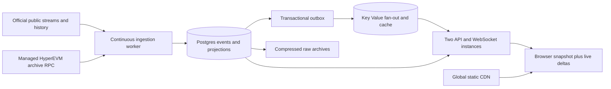

# Papertrade community dashboard plan

Planning baseline: October 9, 2026, America/Los_Angeles. Scope confirmed: public, read-only community analytics; manga editorial design. Recommended launch budget: approximately $270–300/month under the traffic assumptions below. Use managed HyperEVM archive access, a durable indexer, and a CDN frontend. A self-hosted blockchain node is unnecessary at this stage.

The product should feel like a beautifully typeset live manga spread: instantly readable, playful around the edges, and precise about money. Its central interaction is watching community activity and opening a wallet's story without losing your place.

## Existing work and new evidence

This workspace currently contains a Python research CLI and archived protocol research, not a deployed dashboard or Git repository. Keep the CLI and historical research. Paperplay is a separate React/TypeScript/Vite playground with real Hyperliquid prices and simulated trades. Reuse its visual discipline, number formatting, feed validation and connection-state patterns. Its simulation, floating-point accounting and artificial execution delays are not authoritative Papertrade accounting.

The previous September/October 1 research is now materially outdated. The official exchange is available and exposes useful public data. Read-only probes during this session confirmed:

| Capability | Evidence | Product consequence |
| --- | --- | --- |
| Protocol summary | Unauthenticated HTTP 200 from `/query/protocol/summary` | Initial TVL and protocol cards can use an existing source |
| Account directory | HTTP 200 from `/state/leaderboard/accounts`; 5,902 accounts in the sampled response | Discover wallets and build public account pages |
| Deposits | Public wallet `/cashflows` returned three deposits totaling 10,779 USDC | A wallet deposit timeline is immediately feasible |
| Account snapshot | Unauthenticated `/state/user/live?wallet=…` emitted a wallet SSE event; lifetime deposits and balance both matched 10,779 USDC | Live selected-wallet balances and lifetime totals are available |
| Portfolio chart | Public history endpoint returned samples and `coverage.complete: false` | Show coverage explicitly; do not imply complete lifetime equity |
| Community trades | Unauthenticated Centrifuge connection and `public:trades` subscription succeeded | A public stream exists; real execution delivery still needs observation |
| Recent/closed trades | Both public recent feed and sampled wallet history returned empty lists | Connectivity verified; nonempty trade semantics and latency remain untested |
| Deployment | Official bundle publishes contracts; exchange address returned 925 bytes of code | Address discovery has advanced; code existence is not ABI/source verification |

The sampled protocol summary reported about $66.32M in its TVL field, zero trade volume and zero open positions. Treat these as timestamped upstream reports, not independently reconciled custody figures. The directory, protocol summary, trading state and wallet snapshot carry different source revisions; never combine them into an apparently atomic snapshot.

See [data-source evidence](DATA_SOURCES_2026-10-09.md) for endpoints, schemas and validation limits. Primary sources include the [official exchange](https://exchange.papertrade.xyz/trade/btc), [summary endpoint](https://exchange.papertrade.xyz/query/protocol/summary), [account directory](https://exchange.papertrade.xyz/state/leaderboard/accounts) and [published exchange client](https://exchange.papertrade.xyz/assets/index-CvChIo_I.js).

## What we can stream

The global public trade channel describes executed opens, closes and liquidations. Its payload lacks transaction hashes, position IDs and durable event IDs. Recent REST trades add a sequence; the observed client accepts up to 50 recent events, while deeper retention and replay remain unverified. Therefore the channel can power a fast visual ticker, but cannot alone guarantee complete history or exact deduplication.

The public pressure channel exposes aggregate relayer queue information, with a small queue preview. It does not establish a complete public feed of pending wallet orders, sides and sizes. A private relayer partnership would be needed to promise that. An owned node would not expose intents that have not been submitted onchain.

Use two distinct paths:

1. **Fast display:** receive official trade publications centrally, validate them, and present them as source-reported activity. Do not add these unkeyed messages to lifetime aggregates. When an exact mapping to a canonical event is unavailable, keep the temporary ticker separate from durable history.
2. **Durable accounting:** obtain verified contract ABIs, deployment blocks and upgrade history; backfill filtered HyperEVM logs; continuously reconcile gaps; compute wallet and protocol projections from uniquely identified events. Public account history and totals provide a valuable independent comparison and an initial historical source with labeled coverage.

Until the canonical event adapter is verified, public analytics can launch as an explicitly source-backed beta. It must not claim complete global execution history. Start retaining observed raw protocol logs as soon as addresses and deployment boundaries are pinned, even if some decoding is deferred.

## First release

| View | Experience and content |
| --- | --- |
| Community front page | Live trade strip, reported TVL, funded wallets, active traders, volume, open interest, deposits/withdrawals, and source freshness |
| Wallet explorer | Search by address or public display name; stable sort; recent activity; open a wallet drawer on click; full permalink available |
| Wallet story | First seen, lifetime credited deposits, settled withdrawals, net deposits, available balance, locked margin, queued claims, realized PnL, PAPER; trades and cashflows on one filterable timeline |
| Wallet chart | Separate cashflows from returns; distinguish equity, realized PnL and estimated open PnL; show history coverage and gaps |
| Protocol context | LP cash, queued claims, backing and PAPER/staking distributions, with definitions that explain the mechanism |

No wallet connection is needed to read public activity. Address-derived avatars are identity cues, not real-person identification. A public display name is unverified text. Keep personal watchlists in browser storage initially; authenticated profiles and order submission are separate later products.

Empty activity before launch should look intentional: show available deposits and accounts, and say that no trades have been observed. Never manufacture a live tape or a positive PnL history.

## Visual direction

Use Paperplay's cream paper, charcoal ink, generous spacing and oversized tabular numbers as the foundation. The user's chosen manga editorial direction adds asymmetric panel composition, crisp black rules, sparse screentone, expressive hand-drawn accents and a restrained lilac or mint accent. The official uwu mode was inspected through the top-right toggle; translate its playful mood into our own artwork rather than copying its page layout or assets.

The front page should have a strong masthead, an expansive leading number, a community scene in a narrow illustrated panel, and a lively but controlled activity column. A wallet opens like a character dossier: distinctive portrait mark, clear financial summary, and chapters of deposits and trades. Deposits and liquidations can have small ink-stamp accents. Use direct financial labels even when decorative captions are playful.

Art belongs in the composition, not over chart marks or transaction details. Commission or generate original illustrations during the design milestone. Use optimized static SVG/AVIF/WebP, small accent animations and a reduced-motion mode. Avoid full-screen video, continuous particles, animated blur, autoplay sound and illustration downloads on the critical data path. Keep body labels conventional and legible; reserve display typography for headlines. Long/short and profit/loss must remain distinguishable without color.

The first design deliverable is a real front-page and wallet interaction at desktop and mobile widths, using clearly marked fixtures. Review it before extending the same visual system to every view.

## Architecture

Use TypeScript throughout the initial product: React/Vite frontend, Fastify API, a separate Node ingestion process, PostgreSQL, and Redis-compatible Render Key Value. Share schemas, event definitions and exact unit handling. Reuse Paperplay selectively without coupling the two products. [Fastify documentation](https://fastify.dev/docs/latest/).

There is no demonstrated CPU bottleneck that justifies a Rust or Go rewrite. Upstream availability, database access, event fan-out and browser rendering are the performance-critical design choices. A worker can be replaced later behind the same storage and stream contracts if profiling warrants it.

One ingestion service receives global events, rather than opening a subscription per visitor or polling every wallet every second. Public-source bootstrap jobs use bounded concurrency, caching, canonical query ordering, jittered retries and `Retry-After`. Directory pagination can move during crawling: deduplicate addresses, repeat overlapping pages and reconcile counts; a scan is not proof of completeness.

For a beta before event decoding is complete, subscribe on demand to actively viewed wallets through a bounded shared pool. Persist the baseline and lifetime counters. Refresh inactive accounts in a rate-limited background pass, with honest update times. Do not scrape all accounts continuously. Obtain an operator-supported API allowance before depending on these undocumented routes at production volume.

The API serves cached snapshots and keyset-paginated histories from our database. Clients use a single multiplexed WebSocket, with snapshot watermarks and replay cursors. Keep upstream credentials server-side. Sanitize display names, limit searches/subscriptions and bind wallet address formats. Stream only the requested global or wallet topics.

Write events, projections, checkpoints and an outbox record in one database transaction. Publish only after commit. Redis is replaceable; replay comes from Postgres. API instances track stream sequence gaps and resume from the durable log. A periodic outbox-watermark check repairs pub/sub loss even when the browser socket stays connected. If a cursor expires, send a fresh snapshot and its sequence boundary. Slow clients receive a bounded queue and resync instruction rather than unbounded memory growth.

During worker redeploys, use a direct-connection database lease/advisory lock with fencing and unique event keys. Finish or roll back a batch on shutdown. Do not attach Render disks to application services. Keep backend services in one region, selected after measuring provider RTT and likely audience latency. Static assets are globally cached; a single-region API still has geographic latency.

## Accounting and data model

Use integer raw values or PostgreSQL `NUMERIC(78,0)` for EVM units; serialize large values as decimal strings. The current frontend distinguishes 6-decimal native collateral from 18-decimal internal amounts. Keep units attached to every field and convert only at display boundaries. Do not use binary floating point for money or sum already-rounded UI values.

| Record | Purpose and key |
| --- | --- |
| Contract manifest | Chain, addresses, deployment blocks, ABI versions, implementation boundaries and code hashes |
| Raw chain event | Chain/block hash/transaction hash/log index, address/topics/data, observed time and canonical status |
| Account | Wallet address, deposit proxies, first seen/first funded, latest source watermark |
| Position and execution | Contract + position ID; open/close/liquidation, market, side, margin, notional, entry/exit, fees and settlement |
| Cashflow | Deposit received, swept, credited, activation fee, withdrawal requested/settled, manual reconciliation; references linking stages |
| Wallet projection | Current balances and cumulative exact totals, last applied sequence and coverage |
| Protocol and market buckets | Minute/hour/day aggregates; unique funded/trading wallet definitions; no full-history scans per request |
| Snapshots | Time, account revision, equity estimate, price/config version and recorded/reconstructed provenance |
| Outbox and checkpoint | Durable fan-out sequence and source progress |

Cashflow stages matter. A bridge arrival, proxy sweep and credited balance can represent the same money. Sum credited deposits once, preserve received/gross amounts and fees separately when available, and reconcile manual `reconcileSweepCredit` paths. A sampled 10,779 USDC credited total does not establish that the wallet originally sent exactly 10,779 before fees. Count settled withdrawals separately from requests and failures; verify the lifecycle meaning of `withdrawnRaw` before using that counter as a settled total. [Current deposit mechanics](https://docs.papertrade.xyz/#/how/deposits).

Define wallet counts separately: discovered accounts, ever-funded accounts and traders active in a specified window. They are address counts, not people. TVL should initially read **Protocol-reported TVL**. Reconcile its definition against custody and liabilities before calling it independently verified. Queued profit, PAPER balances and open notional are not additional USDC locked; avoid double counting them. Net deposits are not current equity or PnL. Preserve the distinct free LP cash and queued liability definitions in the updated [queue documentation](https://docs.papertrade.xyz/#/how/solvency-queue).

For chain ingestion, order by block/transaction/log index; maintain an overlap window and periodic gap checks. Treat replacement blocks or provider corrections as reconciliation events: retain raw evidence, invalidate affected projections and replay from a known checkpoint. HyperEVM's consensus model informs confirmation policy; an arbitrary Ethereum confirmation count is not a substitute for verifying provider semantics.

## History and growth

Start with Postgres and appropriate wallet/time, market/time and unique event indexes. Use keyset pagination, incremental aggregates and precomputed chart buckets. Partition the high-volume immutable event/history tables by time as volume requires; keep an explicit wallet lookup/index strategy so lifetime wallet queries do not scan every partition. PostgreSQL partitioned uniqueness must include the partition key, so preserve cross-partition deduplication through a correctly scoped event-identity ledger or equivalent proven scheme. [PostgreSQL partitioning](https://www.postgresql.org/docs/current/ddl-partitioning.html).

Keep compact wallet trades/cashflows queryable for the whole supported lifetime. Move bulky raw payloads and replay batches to compressed object storage with checksums and a catalog. Cold storage alone cannot satisfy instant wallet-history queries. If older normalized history moves out of Postgres, introduce a queryable archival tier before doing so, and label its slower retrieval path. Never silently drop old wallet history to meet the budget.

Do not snapshot every wallet at every market tick. Store actual accounting changes, incremental global buckets, shared price series and sampled valuation history for active wallets. Historical equity reconstructed later must disclose price/config gaps; arbitrary old HyperCore precompile values are not always recoverable through archive RPC. [HyperEVM historical-state limitations](https://hyperliquid.gitbook.io/hyperliquid-docs/for-developers/hyperevm/json-rpc).

Illustrative sizing, not an observed traffic forecast: at 1 KB per stored normalized event including selected indexes, 10 events/second produces about 25.9 GB/month; 100/second produces 259 GB/month. Raw payloads, database overhead, replicas and backups add more. Measure bytes per event and projection write amplification on a real sample before choosing retention.

Revisit a columnar analytics store when measured aggregate queries cannot meet targets after indexing/rollups, when history outgrows the operating budget, or when sustained event volume makes Postgres ingestion compete with wallet reads. Keep Postgres for transactional account serving. Budget and benchmark that migration; $300 does not buy unlimited traffic or unlimited online history.

## Node and provider choice

Use QuickNode Build as the initial priced candidate: $49/month on monthly billing, 80M API credits and 50 requests/second. Confirm HyperEVM archive access on the selected account and measure credit consumption. Its documented `/nanoreth` route supports archive data and WebSocket log subscriptions; `/evm` is not interchangeable. Alchemy PAYG is another candidate if measured cost and latency are better. [QuickNode pricing](https://www.quicknode.com/pricing), [HyperEVM endpoint routes](https://www.quicknode.com/docs/hyperliquid/endpoints), [Alchemy HyperEVM](https://www.alchemy.com/hyperevm).

The public RPC has 100 EVM requests/minute, a 50-block `eth_getLogs` range limit and no historical state reads. Use it for lightweight independent checks and limited fallback. HyperCore wallet subscriptions also have a 10-unique-user cap per IP; subscribing to every community wallet is the wrong global ingestion design. [RPC limits](https://hyperliquid.gitbook.io/hyperliquid-docs/for-developers/hyperevm/json-rpc), [API limits](https://hyperliquid.gitbook.io/hyperliquid-docs/for-developers/api/rate-limits-and-user-limits).

The official non-validator node requirements include 16 vCPU and 128 GB RAM, plus substantial disk/log management. This is an operational project of its own and still requires an indexer. Reconsider only if measured provider limitations or a future network-wide data product justify it. [Official node requirements](https://github.com/hyperliquid-dex/node).

## Render budget and deployment blueprint

Prices checked October 9, 2026. The proposed file is [infra/render.blueprint.yaml](../infra/render.blueprint.yaml). It describes the future repository structure and is not currently a runnable application deployment.

The draft passes Render's official JSON Schema (Draft 2020-12), checked locally with PyYAML and jsonschema against the archived schema. This checks configuration shape only. Render CLI/account validation, application builds and production load tests remain implementation-stage checks; no resources were provisioned.

| Monthly component | Lean pilot | Recommended community launch |
| --- | ---: | ---: |
| Pro workspace | $25 | $25 |
| Static frontend/CDN compute | $0 | $0 |
| API/WebSocket | One 1c-2g: $25 | Two 1c-2g: $50 |
| Ingestion worker | 0.5c-512mb: $7 | 1c-2g: $25 |
| Postgres compute | 0.5c-1g: $19 | 1c-4g: $55 |
| Postgres storage | 20 GB: $6 | 50 GB: $15 |
| Key Value | 256 MB: $10 | 256 MB: $10 |
| Fixed Render subtotal | **$92** | **$180** |
| Candidate archive RPC | $49 | $49 |
| Illustrative streaming egress | Usage based | About $35 |
| Initial archive/backup allowance | Usage based | About $5 |
| Working total | **$141 plus usage** | **About $269 plus remaining usage** |

Render Pro includes 25 GB/month outbound transfer; overage is $0.15/GB. The $35 estimate assumes 100 average concurrent viewers receiving 1 KB/second over a 30-day month: 259.2 GB minus the allowance. This excludes page loads and other outbound traffic. At 1,000 average concurrent viewers, that stream alone creates about $385 in overages. Compact deltas, filters, background-tab suspension and bounded fan-out are budget features. [Render pricing](https://render.com/pricing), [outbound bandwidth](https://render.com/docs/outbound-bandwidth).

A $100 pilot is possible using the public-source path and small resources, but leaves little room for paid RPC or growth. For the desired community launch, target $270–300. Taxes, domain registration, exceptional builds, provider overages and larger archives remain extra. Track spend and projected egress; alert at 70% and 90% of the operating budget instead of assuming a fixed cap.

Storage autoscaling is disabled in the draft to make expansion deliberate. Alert at 70%/85% disk utilization and track projected days remaining. Estimate backfill size before starting it; expand storage before it can exhaust headroom. A full Render database can be suspended, so a cost ceiling must never silently become an ingestion outage. [Render storage behavior](https://render.com/docs/postgresql-creating-connecting#running-out-of-storage).

Two API instances improve availability and concurrent serving; they do not double individual request speed. The proposed Postgres, Key Value and ingestion worker are still single instances. Database HA would add roughly $70/month at this sizing, beyond the working total. This is not a fully redundant deployment. Durable replay and tested restoration are essential. [Render HA](https://render.com/docs/postgresql-high-availability).

Paid Postgres on Pro includes seven days of point-in-time recovery. Maintain independent exports/raw archives and test restoration; backups and permanent history serve different purposes. Render has no native object store, so use S3-compatible storage. R2 is a candidate, but account for Render outbound transfer to it. [Backups](https://render.com/docs/postgresql-backups), [R2 pricing](https://developers.cloudflare.com/r2/pricing/).

Blueprint setup prerequisites: create the Git repository and app workspaces; pin runtime/dependencies; implement real scripts; select region and Pro workspace; provision the database first, then create schema owner, ingestion writer and API reader roles; run migrations once; fill the runtime connection URLs and provider/archive secrets before starting services; verify manifest; run builds, Blueprint validation and load tests. This is a staged bootstrap. API binds Render's provided port on `0.0.0.0`. Readiness checks local serving dependencies; stale upstream data remains readable with an explicit freshness status instead of causing restart loops. Enable automatic deployment after CI exists. [Blueprint specification](https://render.com/docs/blueprint-spec), [WebSockets](https://render.com/docs/websocket).

## Performance acceptance targets

These are engineering targets, not measured guarantees. Test desktop and a midrange mobile device on a defined network profile, and report geography.

| Experience | Initial target |
| --- | --- |
| Input response and drawer shell | Under 100 ms locally |
| Prefetched wallet view | Meaningful cached content within 150 ms |
| Warm API p95 | Under 150 ms server-side; network RTT reported separately |
| Uncached indexed wallet history p95 | Under 300 ms server-side at the tested data size |
| UI event after our worker receives it | Under 250 ms p95 under target load |
| Canonical source to screen | Initially aim below 2 seconds p95 when upstream is healthy; measure actual block/provider/indexer lag |
| Browser interactivity | INP below 200 ms; CLS below 0.1; cold LCP below 2 seconds on the agreed profile |
| Burst rendering | Smooth scrolling at 60 Hz without rendering every incoming event independently |

HyperEVM small blocks are approximately one second apart; large blocks have a different cadence. We cannot promise confirmed sub-block executions. Instrument source time/block, received time, database commit, fan-out and client render independently. Official endpoints already expose different watermarks, so visibly stale data must not wear a misleading live badge. [Dual-block architecture](https://hyperliquid.gitbook.io/hyperliquid-docs/for-developers/hyperevm/dual-block-architecture).

Keep initial JavaScript near a 200 KB gzip budget before optional art/charts, with route splitting and measured exceptions. Use narrow state subscriptions, foreground event batching no longer than 100 ms, slower aggregate coalescing, stable row heights, capped live lists, virtualized history, prefetched wallet summaries, tabular numerals and charts drawing independently from the entire React page. Pause auto-insertion while a user inspects older events and show a new-activity count.

Test ingestion at 100 representative events/second or 10x measured peak, whichever is greater, 500 concurrent browser streams initially, and 10M+ realistic history rows before claiming launch capacity. Verify that live ingestion continues within its latency budget during backfill and recovery; throttle historical work when it competes with live writes. Verify zero financial double counts after repeated messages, disconnects, worker overlap and recovery. Sample a deposit/withdrawal and every trade settlement type against receipts and upstream totals. Test Redis outage, database restore, partial source outage, slow consumers, malformed data and upgrade boundaries. Unmeasured capacity is an open item, not a promise.

## Build sequence and completion gates

1. **Data contract and recorder, approximately 1–2 focused days.** Pin addresses and deployment/version evidence; obtain ABI/source; capture first genuine trade publications; inventory event coverage; start checkpointed raw-log retention; agree on public API usage. Gate: sample deposits, opens, closes and liquidations can be explained by source records. Missing launch activity may extend this work.
2. **Art direction and interaction, approximately 2–3 days in parallel.** Build the front page and wallet drawer with labeled fixtures; create original assets; verify mobile, keyboard and reduced-motion behavior. Gate: the two central screens feel coherent and respond within local performance budgets.
3. **Public data beta, approximately 3–5 days.** Connect summary, account discovery, wallet cashflows/history and live ticker through our service; persist observations; expose source age and coverage; deploy the planned infrastructure. Gate: real wallet history is browsable, totals agree on sampled accounts and reconnects are transparent.
4. **Durable history and launch hardening, approximately 3–5 days after ABI access.** Finish historical backfill and canonical projections, reconcile source differences, load-test, recover from forced failures and restore a backup. Gate: no missing/duplicate canonical events over the validation window and measured performance/spend fit the launch tier.
5. **Growth work driven by measurements.** Add analytical storage, replicas or edge fan-out when specific load/latency/cost thresholds are exceeded. Extend social features only after accounting quality and live reliability are established.

Expect roughly 2–3 weeks of focused implementation for a robust first release, with a useful public-data beta earlier. This depends on verified schemas, activity to test, artwork iteration and API access; it is a planning estimate.

The immediate next implementation step is the recorder and source adapter alongside a polished front-page/wallet prototype. Resolve technical unknowns through probes, not a rewrite: full event ABI coverage, reliable deployment start blocks, API retention/rate allowances, nonempty trade delivery, current TVL semantics, historical gaps and upstream freshness are the remaining material questions.
